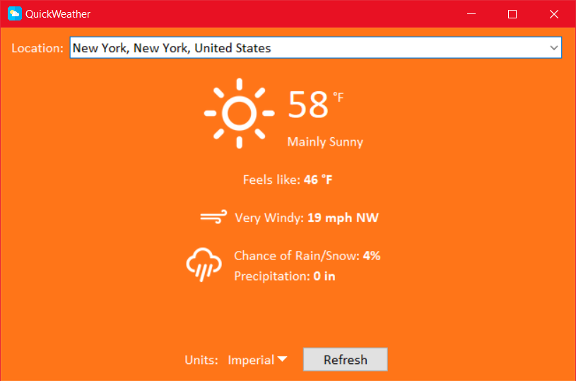

# QuickWeather

A weather app to quickly check the weather. Designed to be simple, colorful, and user-friendly.

*Screenshot:*

## How to run in Python

1. Ensure Python is installed
2. Download or clone source code
    1. `git clone https://github.com/codezinx/quickweather.git`
3. Install the dependencies with `pip`
    1. `pip install -r requirements.txt`
4. Run the app
    1. `python weather.py` or `python3 weather.py`

## Image Sources

- https://www.svgrepo.com/svg/502423/weather
- https://www.flaticon.com/free-icon/weather_831268
- https://icons8.com/icon/9313/sun
- https://thenounproject.com/icon/wind-5292087/
- https://thenounproject.com/icon/rain-7672629/
- https://gist.github.com/stellasphere/9490c195ed2b53c707087c8c2db4ec0c#file-descriptions-json
- https://iconduck.com/sets/weather-icons
- https://open-meteo.com/en/docs